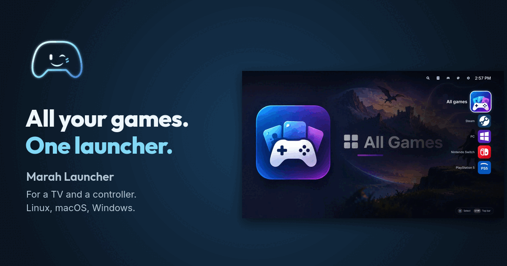

# Marah site

The source of [marahhq.github.io](https://marahhq.github.io), the home page of Marah Launcher and
Marah OS. The page shows what the launcher does, which PCs it runs on, and where to download the
latest release of each.



The picture above is the site's share card (`public/assets/og.png`), not a screenshot of the page.
To see the page, open [marahhq.github.io](https://marahhq.github.io).

## Run it locally

You need Node.js 24 (the version the workflow uses) and Git. The browser tests also need Google
Chrome or Chromium on your `PATH`. Without it, `npm test` skips them.

```sh
git clone https://github.com/MarahHQ/marahhq.github.io
cd marahhq.github.io
npm ci
npm run dev
```

`npm run dev` starts Vite's live preview. It renders the page in the browser only. To see the
prerendered HTML that GitHub Pages serves, run `npm run build`, then `npm run preview`.

## Commands

| Command                | What it does                                                                          |
| ---------------------- | ------------------------------------------------------------------------------------- |
| `npm run dev`          | Starts a live preview that reloads as you edit.                                       |
| `npm run build`        | Builds the site into `dist/` with vite-ssg.                                           |
| `npm run preview`      | Serves `dist/` on a local server.                                                     |
| `npm test`             | Runs the tests on `dist/`. Run `npm run build` first.                                 |
| `npm run typecheck`    | Checks the types with `vue-tsc`.                                                      |
| `npm run lint`         | Runs ESLint.                                                                          |
| `npm run format`       | Formats every file with Prettier. Prettier also sorts the Tailwind classes.           |
| `npm run format:check` | Fails if a file is not formatted.                                                     |
| `npm run check`        | Runs `typecheck`, `lint`, `format:check`, `build`, then `test`. The workflow runs it. |

Run `npm run check` before you open a pull request. With Chrome, it takes a few minutes.

The tests use Node's own test runner and drive headless Chrome directly, with no test packages.
The tests are in `tests/site.test.mjs`. The Chrome driver and a small static server are in
`tests/browser.mjs`.

## How the site is built and deployed

The site is one Vue 3 app with two pages: `/` and `/404`.

1. **Build.** `vite-ssg build` builds the app, then renders each page to static HTML:
   `dist/index.html` and `dist/404.html`. A search engine, a link preview and a visitor without
   JavaScript get the whole page as HTML.
2. **Hydrate.** In the browser, the same Vue app takes over the prerendered HTML. This step is
   called hydration. After it, the tabs, the menu and the other parts that need a script work.
3. **Deploy.** The workflow in [`.github/workflows/pages.yml`](.github/workflows/pages.yml) runs
   `npm run check`, then publishes `dist/` to GitHub Pages. It deploys on each push to `main`. You
   can also start it by hand from the Actions tab. A pull request gets the same check, without the
   deploy.

GitHub Pages serves `dist/404.html` for any address that has no page.

## How release data reaches the page

The page has no version numbers in its HTML. In the browser, `src/composables/useReleases.ts` asks
the GitHub API for the latest release of [marah-launcher](https://github.com/MarahHQ/marah-launcher)
and [marah-os](https://github.com/MarahHQ/marah-os). It reads each release's tag, date and file
sizes, and the SHA-256 that GitHub has for each file.

The browser keeps each answer in `localStorage` for one hour. GitHub allows 60 calls an hour for
each visitor, and this cache keeps the page to two. So a new launcher or Marah OS release shows on
the page without a rebuild: at once for a new visitor, and within an hour for a visitor who has the
old release in the cache.

If the page can't read GitHub, it shows "The latest release" in place of the version. The download
links still work, because they point at GitHub's latest release.

## Where to change things

| To change                               | Edit                                                                      |
| --------------------------------------- | ------------------------------------------------------------------------- |
| The words, lists and links of a section | Its file in `src/content/`, for example `src/content/faq.ts`              |
| The site's title, description and links | `src/content/site.ts`                                                     |
| The header's links                      | `src/content/nav.ts`                                                      |
| The order of the sections               | `src/pages/HomePage.vue`                                                  |
| The layout of a section                 | Its component in `src/components/sections/`                               |
| A shadcn-vue component                  | Its folder in `src/components/ui/`                                        |
| The dark theme's colours                | The CSS variables in `src/style.css`                                      |
| The light theme's colours               | The CSS variables in `src/styles/base.css`                                |
| The fonts, text sizes and page widths   | `src/style.css`                                                           |
| Images, fonts and icons                 | `public/assets/`. Vite copies `public/` as it is, so the URLs stay fixed. |

A string in `src/content/` that holds a link or `<code>` is HTML. The `RichText` component shows
it.

A test checks that each text colour has a contrast of at least 4.5:1 on each surface, in both
themes. Run `npm run check` after you change a colour.

[docs/how-the-site-works.md](docs/how-the-site-works.md) has the full file map and the rules that
keep the page working without JavaScript and in both themes. Read it before you change a
component.

## Add a shadcn-vue component

shadcn-vue is a set of components that its CLI copies into your repo as source. The site's copies
of `Button`, `Accordion`, `Tabs` and `Sheet` are in `src/components/ui/`. They are our code now,
restyled to the site's look. `components.json` holds the CLI's settings.

The CLI also changes files that the site keeps as they are. So add a component in five steps:

1. Run the CLI, for example for `badge`:

   ```sh
   npx shadcn-vue@latest add badge
   ```

2. Undo the CLI's changes outside the new folder. The CLI adds packages, loosens the pinned
   versions, and adds a Google Fonts import and base styles to `src/style.css`:

   ```sh
   git checkout -- package.json package-lock.json src/style.css
   npm ci
   ```

3. In the new files, change `import { cn } from 'cn'` to `import { cn } from "@/lib/utils"`.
4. Run `npm run format`.
5. Restyle the component with its own classes, then run `npm run check`.

These steps were checked with shadcn-vue 2.9.0. A later CLI can change other files, so check
`git status` after step 1.

The state variants that the components use (`data-open:`, `data-closed:` and the rest) are a copy
in `src/styles/shadcn.css`. So the build does not need the CLI's package.

The site's `cn` helper (in `src/lib/utils.ts`) joins class names. It does not merge Tailwind
classes that clash, because the merge code would add about 12 kB (gzip) to each page. So change a
component's own classes. Do not override them from outside.

## Conventions

- **TypeScript in strict mode.** Components use `<script setup lang="ts">`. `vue-tsc` checks the
  types.
- **Lint and format.** ESLint uses Vue's and typescript-eslint's recommended rules
  (`eslint.config.mjs`). Prettier formats every file, Markdown too, at 120 characters a line
  (`.prettierrc.json`).
- **Commits.** Commit messages follow [Conventional Commits](https://www.conventionalcommits.org),
  for example `fix: the 404 page follows the light theme`. No tool enforces this.
- **Exact versions.** `package.json` pins each package to one version. `npm ci` installs the
  versions in `package-lock.json`.

## Facts from other repositories

Some facts on the page come from the launcher and Marah OS repositories. Change them there first,
then here.

| Fact on the page                   | Source                                                                        | File here                   |
| ---------------------------------- | ----------------------------------------------------------------------------- | --------------------------- |
| The controller's keys              | `docs/user-guide.md` in marah-launcher                                        | `src/content/controller.ts` |
| What a PC needs for an emulator    | The `[requires]` table in an emulator's `plugin.toml`, in marah-launcher      | `src/content/willItRun.ts`  |
| The words for how well a game runs | `crates/core/src/view.rs` and `crates/core/src/hardware.rs` in marah-launcher | `src/content/willItRun.ts`  |
| The steps to install Marah OS      | The marah-os README                                                           | `src/content/marahOs.ts`    |

## Licence

The site is free software under the [GNU GPL, version 3 or later](LICENSE).

The Ubuntu and Ubuntu Mono fonts in `public/assets/fonts/` are under the
[Ubuntu Font Licence](public/assets/fonts/UFL-Ubuntu.txt). The covers in `public/assets/demo/` are
the games' official art. They are here to show the launcher.
